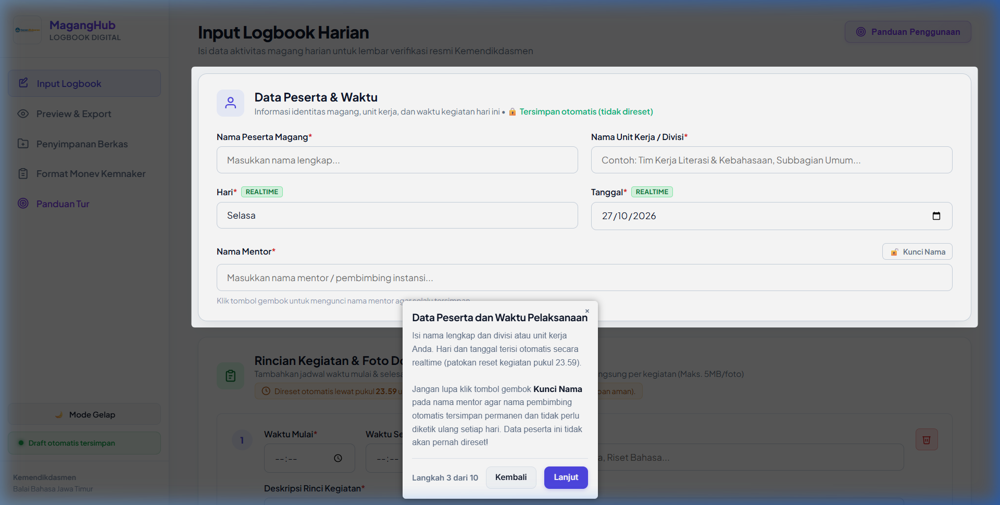
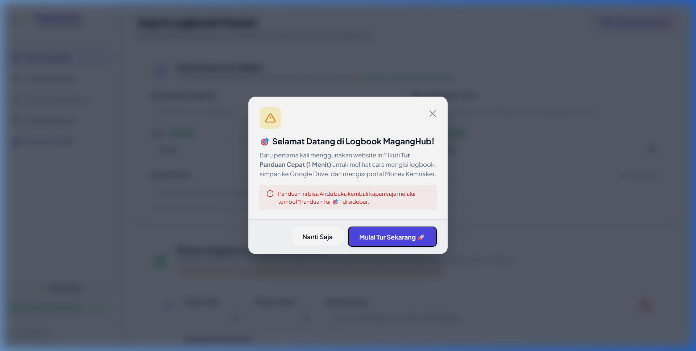
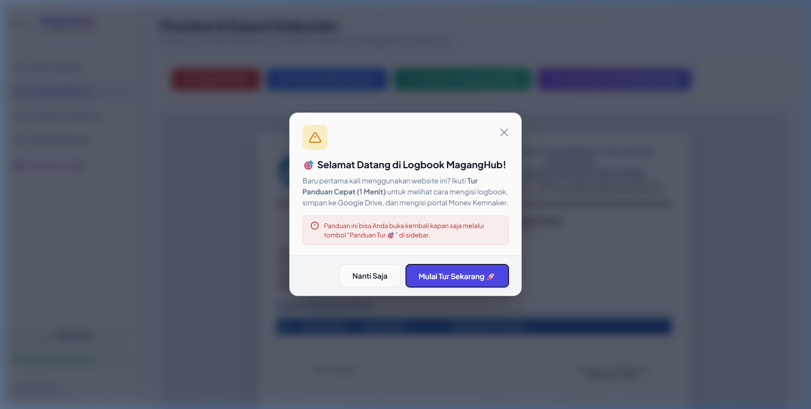
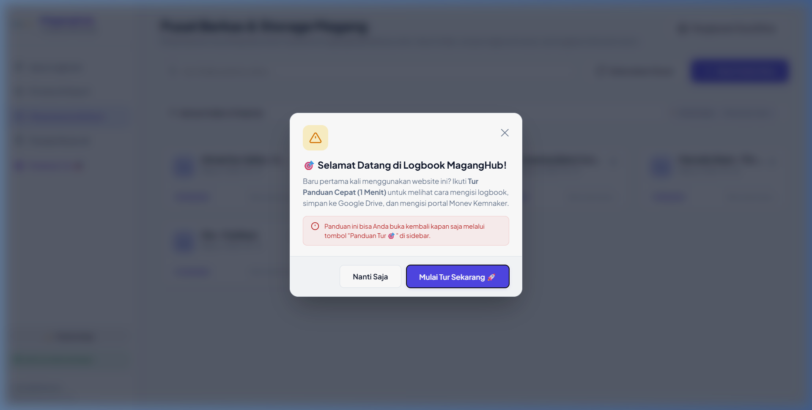
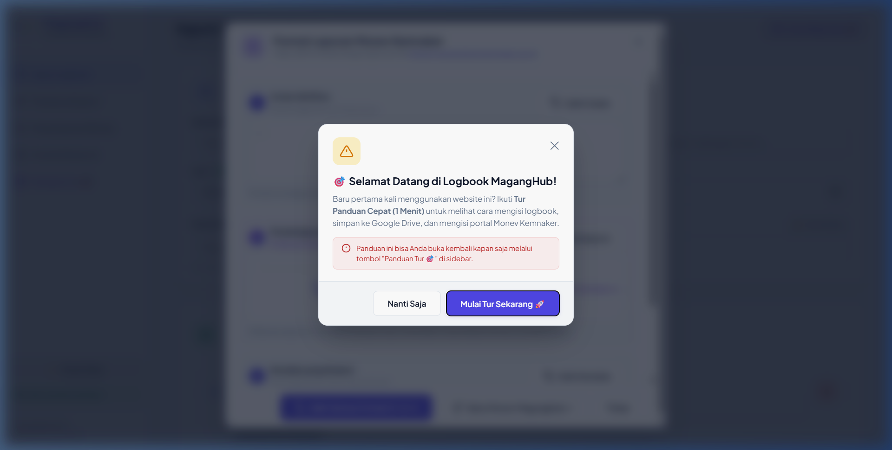

# 📘 BUKU PANDUAN PENGGUNA
## Website Logbook Digital & Monev Kemnaker
**Balai Bahasa Provinsi Jawa Timur — Kemendikdasmen**  
*Khusus untuk 33 Peserta MagangHub Kemendikdasmen*

---

## 📑 DAFTAR ISI
1. [Sekilas Tentang Aplikasi](#1-sekilas-tentang-aplikasi)
2. [Fitur Panduan Interaktif (Tur Driver.js)](#2-fitur-panduan-interaktif-tur-driverjs)
   - [A. Cara Mengaktifkan Tur](#a-cara-mengaktifkan-tur)
   - [B. Rincian Alur 10 Langkah Tur Panduan](#b-rincian-alur-10-langkah-tur-panduan)
3. [Langkah 1: Mengisi Formulir Logbook Harian (Tab 1)](#3-langkah-1-mengisi-formulir-logbook-harian-tab-1)
   - [A. Mengisi Data Peserta & Waktu](#a-mengisi-data-peserta--waktu)
   - [B. Fitur Kunci Nama Mentor (🔒)](#b-fitur-kunci-nama-mentor-)
   - [C. Mengisi Rincian Kegiatan & Foto Dokumentasi](#c-mengisi-rincian-kegiatan--foto-dokumentasi)
   - [D. Tanda Tangan Digital (Peserta & Mentor)](#d-tanda-tangan-digital-peserta--mentor)
   - [E. Aturan Reset Otomatis Lewat Pukul 23.59](#e-aturan-reset-otomatis-lewat-pukul-2359)
4. [Langkah 2: Pratinjau & Unduh Dokumen Resmi (Tab 2)](#4-langkah-2-pratinjau--unduh-dokumen-resmi-tab-2)
5. [Langkah 3: Sinkronisasi ke Google Drive Koordinator (Tab 3)](#5-langkah-3-sinkronisasi-ke-google-drive-koordinator-tab-3)
   - [A. Memilih / Membuat Folder Nama Anda](#a-memilih--membuat-folder-nama-anda)
   - [B. Fitur Bintang (⭐) Agar Folder Selalu Terpin di Paling Atas](#b-fitur-bintang--agar-folder-selalu-terpin-di-paling-atas)
   - [C. Menyimpan Logbook & Mendapatkan Tautan Google Drive](#c-menyimpan-logbook--mendapatkan-tautan-google-drive)
   - [D. Prosedur Revisi Dokumen jika Terjadi Kekeliruan](#d-prosedur-revisi-dokumen-jika-terjadi-kekeliruan)
6. [Langkah 4: Format Laporan Monev Kemnaker (3 Klip Siap Salin)](#6-langkah-4-format-laporan-monev-kemnaker-3-klip-siap-salin)
   - [A. Clip 1: Uraian Aktifitas Kronologis + Link GDrive](#a-clip-1-uraian-aktifitas-kronologis--link-gdrive)
   - [B. Clip 2: Pembelajaran yang Didapat (Refleksi & Kompetensi AI Gemini)](#b-clip-2-pembelajaran-yang-didapat-refleksi--kompetensi-ai-gemini)
   - [C. Clip 3: Kendala yang Dialami (Evaluasi Positif Otomatis jika Kosong)](#c-clip-3-kendala-yang-dialami-evaluasi-positif-otomatis-jika-kosong)
   - [D. Cara Menempel ke Website Monev Kemnaker](#d-cara-menempel-ke-website-monev-kemnaker)
7. [Tanya Jawab & Tips Penting (FAQ)](#7-tanya-jawab--tips-penting-faq)

---

## 1. Sekilas Tentang Aplikasi
Website Logbook MagangHub adalah platform pelaporan terpadu yang dirancang untuk seluruh 33 peserta magang di lingkungan Balai Bahasa Provinsi Jawa Timur. Aplikasi ini menyatukan 4 kebutuhan utama:
1. **Pencatatan Harian Rapi:** Otomatis dilengkapi jam mulai-selesai WIB, deskripsi kegiatan terjustifikasi, foto dokumentasi, dan tanda tangan digital.
2. **Export Dokumen Resmi:** Langsung menghasilkan lembar logbook resmi dengan Kop Surat Kemendikdasmen dalam format **Word (.docx)** dan **PDF (.pdf)**.
3. **Penyimpanan Cloud Terpusat:** Sinkronisasi langsung ke Google Drive koordinator dengan folder khusus untuk masing-masing peserta.
4. **Rangkuman Laporan Monev Kemnaker:** Menyusun ringkasan 3 klip siap salin untuk portal [https://monev.maganghub.kemnaker.go.id/](https://monev.maganghub.kemnaker.go.id/).

---

## 2. Fitur Panduan Interaktif (Tur Driver.js)
Jika Anda baru pertama kali membuka website ini atau lupa letak menu tertentu, gunakan fitur **Panduan Tur Interaktif** berbasis **Driver.js**:

### A. Cara Mengaktifkan Tur:
1. Klik tombol **"Panduan Penggunaan"** di pojok kanan atas formulir input, ATAU
2. Klik menu **"Panduan Tur"** pada panel navigasi (sidebar kiri).
3. Tur otomatis berjalan dan memandu Anda langkah demi langkah dengan menyorot elemen penting formulir dan berpindah tab secara otomatis.
4. Klik tombol **Lanjut** untuk berpindah ke langkah berikutnya, **Kembali** untuk mundur satu langkah, atau **Selesai** untuk menutup panduan.

### B. Rincian Alur 10 Langkah Tur Panduan:
| No. Langkah | Target Sorotan | Penjelasan & Tindakan |
| :---: | :--- | :--- |
| **1** | **Panel Sidebar Kiri** (`#sidebar`) | Pengenalan singkat aplikasi resmi Logbook MagangHub untuk 33 peserta magang Balai Bahasa Jawa Timur. |
| **2** | **Menu Tab 1: Input Logbook** (`#nav-form`) | Halaman utama pengisian agenda. Seluruh isian otomatis disimpan ke memori browser (*Auto-save*). |
| **3** | **Data Peserta & Waktu Pelaksanaan** (`#card-peserta-waktu`) | Pengisian Nama Peserta, Unit Divisi, Hari & Tanggal (realtime). Penggunaan fitur kunci gembok nama mentor agar tersimpan permanen. Data di card ini tidak pernah direset. |
| **4** | **Rincian Kegiatan & Dokumentasi** (`#kegiatan-list`) | Pengisian jam mulai-selesai (WIB), deskripsi kegiatan, tombol tambah kegiatan baru, serta upload foto dokumentasi (maks 5MB). Bagian ini yang otomatis dikosongkan lewat pukul 23.59 malam. |
| **5** | **Catatan atau Kendala Tambahan** (`#catatan`) | Catatan evaluasi kerja. **Jika tidak ada kendala, cukup dikosongkan saja**; AI Gemini akan otomatis menyusun narasi evaluasi positif untuk portal Monev Kemnaker. |
| **6** | **Tanda Tangan Digital** (`.signature-container`) | Coretan tanda tangan langsung pada canvas atau upload foto TTD. Tanda tangan peserta dan mentor tetap tersimpan permanen dan tidak akan hilang. |
| **7** | **Tab 2: Pratinjau & Export Dokumen** (`.export-toolbar`) | Layar otomatis berpindah ke Tab Preview. Menjelaskan pengecekan berkas berkop surat resmi serta pilihan tombol **Export ke Word (.docx)** dan **Export ke PDF (.pdf)**. |
| **8** | **Tab 3: Penyimpanan Berkas & Drive** (`.storage-action-bar`) | Layar otomatis berpindah ke Tab Storage. Menjelaskan pembuatan folder baru untuk peserta baru, pin bintang (⭐), penyimpanan ke Google Drive bersama milik Marcello, serta **aturan revisi dokumen**. |
| **9** | **Format Laporan Monev Kemnaker** (`#nav-monev`) | Menjelaskan 3 Klip Siap Salin: Uraian dari form + link Drive, Pembelajaran otomatis dari AI Gemini, serta Kendala yang otomatis positif jika dikosongkan. |
| **10** | **Tombol Mode Tampilan** (`#theme-toggle-btn`) | Opsi beralih antara Mode Terang dan Mode Gelap (*Dark Mode*) untuk kenyamanan mata saat bekerja. |

---

## 3. Langkah 1: Mengisi Formulir Logbook Harian (Tab 1)

### A. Mengisi Data Peserta & Waktu
- **Nama Peserta Magang:** Masukkan nama lengkap Anda (contoh: *Marcello Ilham*).
- **Nama Unit Kerja / Divisi:** Masukkan unit tugas Anda (contoh: *Tim Kerja Pelindungan & Modernisasi Bahasa dan Sastra*).
- **Hari & Tanggal:** Terisi **otomatis secara realtime**. Anda tidak perlu mengubahnya kecuali ingin membuat logbook susulan hari sebelumnya.

> 🔒 **PENTING:** Nama dan unit kerja Anda **tersimpan permanen** di memori browser. Anda tidak perlu mengetik ulang setiap hari!

---

### B. Fitur Kunci Nama Mentor (🔒)
1. Ketik nama mentor pembimbing instansi Anda di kolom **Nama Mentor**.
2. Klik tombol **"🔓 Kunci Nama"** di samping label.
3. Tombol akan berubah menjadi **"🔒 Terkunci"**.
4. Nama mentor Anda kini aman tersimpan permanen setiap hari tanpa perlu repot mengetik ulang.

---

### C. Mengisi Rincian Kegiatan & Foto Dokumentasi
1. **Waktu Pelaksanaan:** Atur jam mulai dan selesai kegiatan (format otomatis WIB, contoh: `08:00 - 09:30 WIB`).
2. **Nama Kegiatan:** Tuliskan judul agenda (contoh: *Presentasi Pagi Sistem SEMERU* atau *Rapat Koordinasi Kemah Cerpen*).
3. **Deskripsi:** Tuliskan penjelasan aktivitas secara rinci.
4. **Foto Dokumentasi (Maks. 5MB):** Klik tombol **"Upload Foto Dokumentasi"** untuk melampirkan foto kegiatan langsung pada baris agenda terkait.
5. **Menambah Kegiatan:** Jika dalam sehari Anda memiliki lebih dari 1 agenda, klik tombol biru **"Tambah Kegiatan Baru"** di bagian bawah.

---

### D. Tanda Tangan Digital (Peserta & Mentor)
1. **Goreskan Tanda Tangan:** Coretkan tanda tangan langsung pada kotak canvas putih menggunakan mouse, touchpad, atau stylus pen pada layar sentuh.
2. **Upload Foto TTD:** Jika Anda memiliki file foto tanda tangan (PNG/JPG), klik tombol **"Upload Foto TTD"** di sudut kanan atas kotak.
3. Tombol **"Hapus"** hanya digunakan jika Anda ingin menggambar ulang tanda tangan dari awal.

> 🔒 **CATATAN AMAN:** Tanda tangan digital peserta dan mentor **TETAP TERSIMPAN** dan **TIDAK AKAN HILANG** saat pergantian hari.

---

### E. Aturan Reset Otomatis Lewat Pukul 23.59
Website memiliki sistem manajemen waktu cerdas untuk kenyamanan seluruh peserta magang:

| Komponen Formulir | Setelah Lewat Pukul 23.59 | Alasan & Manfaat |
| :--- | :---: | :--- |
| **Rincian Kegiatan** | 🔄 **DI-RESET (Dikosongkan)** | Menyiapkan lembar bersih untuk mencatat agenda hari baru. |
| **Foto Dokumentasi** | 🔄 **DI-RESET (Dikosongkan)** | Foto kegiatan hari sebelumnya dibersihkan untuk hari baru. |
| **Catatan / Kendala** | 🔄 **DI-RESET (Dikosongkan)** | Menyiapkan catatan evaluasi baru. |
| **Data Peserta & Unit** | 🔒 **TETAP TERSIMPAN** | Anda tidak perlu repot mengetik nama & unit lagi. |
| **Nama Mentor (Terkunci)** | 🔒 **TETAP TERSIMPAN** | Tetap terkunci dan selalu terisi otomatis. |
| **Tanda Tangan Digital** | 🔒 **TETAP TERSIMPAN** | Coretan tanda tangan tidak hilang setiap hari. |
| **Hari & Tanggal** | ⚡ **REALTIME HARI BARU** | Otomatis sinkron dengan hari aktif kalender saat ini. |

---

## 4. Langkah 2: Pratinjau & Unduh Dokumen Resmi (Tab 2)

Setelah mengisi formulir di Tab 1, buka menu **"Preview & Export"** di sidebar (atau klik tombol **Lihat Preview & Export** di bawah formulir):
1. Lembar dokumen resmi akan tampil lengkap dengan **Kop Surat Kementerian Pendidikan Dasar dan Menengah**, tabel rincian kegiatan, lampiran foto dokumentasi, dan kolom tanda tangan pengesahan.
2. Klik **"Export ke Word (.docx)"** untuk mendownload file Microsoft Word yang dapat disunting kembali.
3. Klik **"Export ke PDF"** untuk mendownload dokumen PDF siap cetak berkualitas tinggi.
4. Klik **"Simpan ke Drive / Storage"** untuk langsung menyimpan berkas ke Google Drive koordinator.

---

## 5. Langkah 3: Sinkronisasi ke Google Drive Koordinator (Tab 3)

Tab **Penyimpanan Berkas** terhubung langsung secara realtime dengan folder Google Drive resmi koordinator (Google Apps Script).

### A. Memilih / Membuat Folder Nama Anda
1. Di halaman ini, Anda akan melihat kartu folder milik 33 peserta magang.
2. Gunakan kolom pencarian di bagian atas untuk mengetik nama Anda.
3. Jika folder nama Anda belum ada, klik tombol **"Buat Folder Baru"**, ketik nama lengkap Anda (contoh: `Marcello Ilham - Tim Pelindungan`), lalu klik Buat Folder.

---

### B. Fitur Bintang (⭐) Agar Folder Selalu Terpin di Paling Atas
Agar Anda tidak perlu mencari-cari nama folder Anda di antara 33 peserta setiap hari:
1. Arahkan mouse ke kartu folder nama Anda.
2. Klik ikon **Bintang (⭐)** di sudut kanan atas kartu folder.
3. Folder Anda akan berubah menjadi warna keemasan berlabel **Dipin** dan otomatis selalu berada di **urutan pertama paling atas**!

---

### C. Menyimpan Logbook & Mendapatkan Tautan Google Drive
1. Klik folder nama Anda untuk membukanya.
   > 💡 **DATA TIDAK AKAN HILANG:** Seluruh data yang sudah Anda isi pada Tab 1 (Input Logbook) **tetap aman tersimpan** dan tidak akan terhapus saat Anda membuka menu penyimpanan ataupun membuka folder nama Anda!
2. Di bagian atas terdapat panel hijau **Simpan Logbook Hari Ini ke Folder Ini**.
3. Pilih format berkas yang diinginkan: **Word (.docx)** atau **PDF (.pdf)**.
4. Klik tombol **"Simpan & Dapatkan Link Google Drive"**.
5. Berkas otomatis ter-generate dan tersimpan langsung ke **Google Drive bersama milik koordinator (Marcello)**.
6. Setelah pengunggahan berhasil, muncul banner sukses lengkap dengan **Link Google Drive resmi**.
7. Klik tombol **"Salin Link"** untuk menggunakannya sebagai lampiran resmi.

---

### D. Prosedur Revisi Dokumen jika Terjadi Kekeliruan
> ⚠️ **ATURAN PENTING REVISI FILE GOOGLE DRIVE:**  
> File yang sudah tersimpan di Google Drive koordinator **tidak dapat diedit secara langsung** dari dalam Drive.  
> Jika terdapat salah ketik pada kegiatan, deskripsi, atau foto dokumentasi yang keliru, ikuti alur revisi berikut:
>
> 1. **Hapus File Lama:** Buka folder nama Anda di Tab **Penyimpanan Berkas**, temukan file logbook yang keliru, lalu klik tombol **Hapus** (ikon tempat sampah).
> 2. **Perbaiki Isian Data:** Klik menu **Input Logbook** (Tab 1) di sidebar. Koreksi kegiatan atau data yang keliru (seluruh isian Anda sebelumnya masih tetap ada).
> 3. **Simpan Ulang:** Masuk kembali ke Tab **Penyimpanan Berkas**, buka folder nama Anda, lalu klik tombol **"Simpan & Dapatkan Link Google Drive"** sekali lagi.
> 4. **Salin Tautan Baru:** Sistem akan membuat berkas baru dan menghasilkan link Google Drive baru. Klik **Salin Link**, lalu tempelkan link baru tersebut ke portal Kemnaker. Selesai!

---

## 6. Langkah 4: Format Laporan Monev Kemnaker (3 Klip Siap Salin)

Untuk mengisi laporan harian pada portal [https://monev.maganghub.kemnaker.go.id/](https://monev.maganghub.kemnaker.go.id/), Anda tidak perlu mengetik satu per satu dari awal! Cukup klik tombol **"Format Monev Kemnaker"** di sidebar atau tombol **Format Monev (3 Clip)** di formulir.

Jendela popup akan menampilkan **3 Klip Siap Salin**:

### A. Clip 1: Uraian Aktifitas Kronologis + Link GDrive
- **Isi:** Mengambil langsung dari input formulir logbook sebelumnya. Tersusun secara kronologis berpenomoran rapi lengkap dengan jam pelaksanaan (WIB), judul kegiatan, dan rincian uraian tugas Anda.
- **Tautan Berkas:** Jika logbook sudah tersimpan ke penyimpanan Google Drive koordinator Marcello, tautan (*link*) berkas Google Drive otomatis disematkan di baris paling bawah sebagai lampiran bukti digital resmi.
- Klik tombol **"Salin Uraian"**.

---

### B. Clip 2: Pembelajaran yang Didapat (Refleksi & Kompetensi AI Gemini)
- **Isi:** Di-generate secara otomatis dan cerdas oleh **AI Gemini** berdasarkan tugas nyata yang telah Anda inputkan di formulir logbook harian.
- Menghasilkan 2–3 poin refleksi terstruktur dengan judul kategori kompetensi profesional (contoh: *Manajemen Acara & Literasi Daerah:*, *Pengembangan Tools Produktivitas:*, *Kolaborasi Lintas Peran:*), dan setiap poin dipisahkan oleh satu baris kosong (line break) yang rapi.
- Tanpa tulisan pembuka atau tanda format yang mengganggu, sehingga 100% siap tempel.
- Tersedia tombol **"Perbarui Refleksi"** jika Anda ingin variasi susunan narasi lain.
- Klik tombol **"Salin Pembelajaran"**.

---

### C. Clip 3: Kendala yang Dialami (Evaluasi Positif Otomatis jika Kosong)
- **Isi:** Mengambil langsung dari inputan *Catatan / Kendala Tambahan*.
- **Otomatis Cerdas jika Dikosongkan:** Jika selama kegiatan magang hari ini Anda tidak mengalami hambatan apa pun, **cukup kosongkan saja kolom catatan pada formulir input logbook**. Sistem AI Gemini akan otomatis menyusun narasi evaluasi positif dan profesional, contoh:
  > *"Tidak ada kendala. Seluruh agenda kegiatan mulai dari [kegiatan 1] hingga [kegiatan 2] berjalan dengan sangat lancar dan sesuai target waktu yang direncanakan."*
- Klik tombol **"Salin Kendala"**.

---

### D. Cara Menempel ke Website Monev Kemnaker
1. Klik tombol **"Buka Portal Monev Kemnaker"** di pojok kanan atas modal (akan membuka [https://monev.maganghub.kemnaker.go.id/](https://monev.maganghub.kemnaker.go.id/) di tab baru).
2. Login ke akun MagangHub Kemnaker Anda.
3. Buka menu Laporan Harian Monev.
4. Tempelkan (*Paste* / Ctrl+V):
   - **Clip 1** pada kolom **Uraian Aktifitas**.
   - **Clip 2** pada kolom **Pembelajaran yang Didapat**.
   - **Clip 3** pada kolom **Kendala yang Dihadapi**.
5. Klik **Simpan / Kirim Laporan** di portal Kemnaker. Selesai dalam waktu kurang dari 1 menit! 🎉

---

## 7. Tanya Jawab & Tips Penting (FAQ)

### Q: Apakah data saya akan hilang jika laptop mati atau browser tertutup?
**J:** Tidak. Aplikasi ini memiliki fitur **Auto-save** otomatis ke penyimpanan lokal browser (*localStorage*) setiap 400 milidetik saat Anda mengetik. Ketika website dibuka kembali, data Anda akan langsung muncul kembali.

### Q: Kapan rincian kegiatan saya akan terhapus otomatis?
**J:** Hanya ketika waktu telah melewati pukul **23.59 malam** (pergantian hari ke pukul 00.00). Ini bertujuan agar saat Anda bangun di pagi hari, formulir rincian kegiatan sudah bersih dan siap diisi untuk agenda hari ini.

### Q: Apakah nama saya dan tanda tangan saya ikut terhapus saat lewat 23.59?
**J:** **TIDAK.** Data Peserta (Nama, Unit, Mentor) dan Tanda Tangan Digital **TETAP AMAN TERSIMPAN** dan tidak akan pernah ikut terhapus.

### Q: Bagaimana jika laptop teman saya belum melihat folder baru yang saya buat di Google Drive?
**J:** Sistem melakukan sinkronisasi otomatis setiap 30 detik. Anda juga bisa mengklik tombol **"Sinkronkan Berkas"** di pojok kanan atas Tab Penyimpanan Berkas untuk memperbarui daftar folder secara instan.

### Q: Jika ada kesalahan isi logbook yang sudah terlanjur disimpan ke Google Drive, apakah bisa diedit langsung?
**J:** Tidak bisa diedit langsung di Google Drive. Sesuai prosedur, silakan hapus file yang salah tersebut di folder Anda pada Tab **Penyimpanan Berkas**, lalu kembali ke Tab **Input Logbook** untuk mengoreksi isian data atau fotonya (data Anda di form tidak hilang). Setelah benar, buka kembali folder nama Anda di Tab Penyimpanan Berkas dan klik tombol **"Simpan & Dapatkan Link Google Drive"** untuk menghasilkan berkas dan link baru yang siap disalin ke portal Monev Kemnaker.

### Q: Bagaimana cara mengganti tema ke Mode Gelap?
**J:** Klik tombol **"Mode Gelap 🌙"** di bagian bawah panel sidebar navigasi kiri (atau ikon bulan pada perangkat smartphone).

---

*Hak Cipta © 2026 Tim Pengembang Logbook MagangHub — Balai Bahasa Provinsi Jawa Timur, Kementerian Pendidikan Dasar dan Menengah.*
